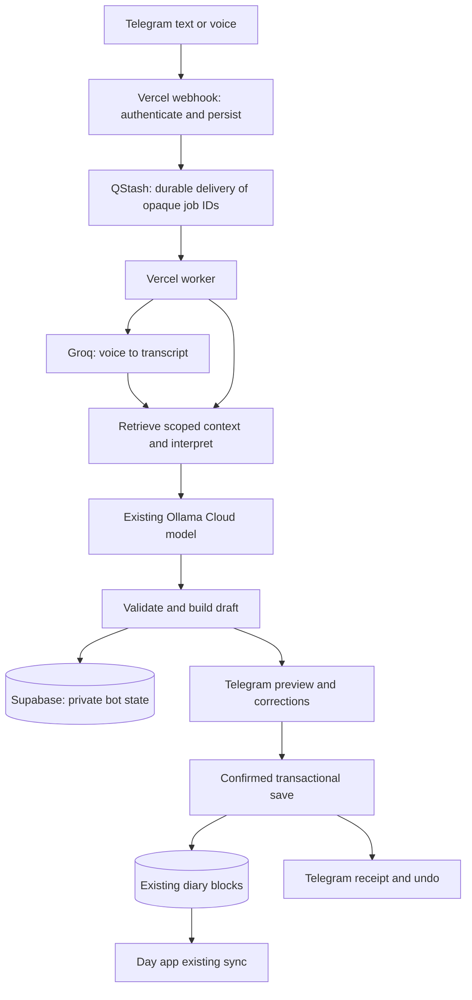

# Telegram text and voice integration plan

Prepared 26 October 2026. Status: proposed implementation plan; no bot, credentials, migrations or deployment created by this document.

Implementation update: the local adapter and migration are now built and tested;
see [setup and remaining release gates](telegram-setup.md) and the
[validation report](telegram-validation.md). The plan below records the intended
design; the setup document identifies current pilot boundaries.

**Outcome:** send a Telegram text or voice note, review what Day understood, confirm it, and have the same diary data updated while the Mac and browser are closed. Existing app controls and data formats keep their behavior. MCP is optional future access to the same command service, not a prerequisite for Telegram.

## 1. Daily workflow

1. Send “Yesterday I worked from nine to eleven, then went to the gym until twelve. Energy four out of five.”
2. For voice, the bot downloads the recording and obtains a transcript. Text skips transcription.
3. The bot resolves dates in Europe/London, reads only relevant saved data, and builds validated proposed changes.
4. It shows a compact preview with exact dates, times and affected records. Voice previews include the transcript or a button to view it. Missing information produces one focused question; nothing saves yet.
5. Reply “make that half past nine,” type a correction, or send another voice note. The bot revises the pending preview.
6. Tap **Save**, **Change**, or **Cancel**. Explicit “save” in text or voice can confirm the single current draft. A voice confirmation must resolve to an unambiguous control command; “don't save” must never save.
7. A successful database commit produces a receipt and **Undo** button. The normal app sees the saved data through its existing reload/sync behavior.

Read-only questions, such as “What did I log yesterday?”, need no save confirmation. `/status` retrieves pending work and the latest receipt after a connection failure. `/cancel`, `/undo`, `/help` and `/unlink` have deterministic handlers and do not depend on the language model.

Initial defaults: one owner, private chat only, English first, two-minute voice notes, ten-megabyte download cap, one active draft, 24-hour draft expiry and seven-day undo availability. These are configurable product limits, not provider guarantees.

## 2. Scope and app boundary

| Capability | First release |
| --- | --- |
| Log activities and reflections, including overnight blocks | Yes, using existing half-hour slots and validation |
| Move, rename, recategorize or delete saved activities | Yes, with exact target selection and visible collision handling |
| Add, complete or remove supported objectives | Yes, including linked completion where all affected records can be loaded |
| Add rough plans, energy/satisfaction ratings and day status | Yes |
| Append to an existing note | Yes; disambiguate duplicate titles |
| Ask about a day or saved activity totals | Yes, computed from retrieved records rather than invented by the model |
| Correct a draft, save, cancel, recover status, undo | Yes |
| “Open my notes/calendar” | Reply with useful app navigation/link or chat summary; never pretend to control an open browser |
| Google Calendar edits, structured gym sets, note-project management, account settings | Outside the current voice action set; separate later work |
| New note creation/full note editing, recurring reminders, photos and documents | Later increments after the core release is proven |

Create an explicit capability inventory from real user phrases before implementation. Every phrase must map to a supported operation, a clarification, or an honest unsupported response. “Everything by voice” cannot mean every base-app operation automatically exists in the current command engine.

Telegram cannot see unsynced browser changes or the currently selected browser item. “This activity” requires an explicit chat selection. Unsynced edits need syncing before conflicting remote changes; changing the app's offline reconciliation is a separate scope decision. No framework rewrite, new diary storage format or changes to the behavior of normal controls are planned. One optional authenticated connection page is an additive integration surface.

## 3. Recommended architecture and cost

Use Node handlers for the new adapter so it can import the existing pure JavaScript planning modules. Keep existing Python voice endpoints working. Share a versioned model contract and test normalization across runtimes rather than maintain two independently drifting prompts. Do not call the browser adapter on a server or make a redundant public Node-to-Python HTTP hop merely to reuse a prompt.

| Component | Choice and cost boundary |
| --- | --- |
| Messaging | Telegram's bot platform is free for ordinary use. [Telegram platform](https://core.telegram.org/bots) |
| Hosting | Existing Vercel project, subject to its actual plan, resource allowance and runtime settings. Check these before rollout. [Function limits](https://vercel.com/docs/functions/limitations) |
| Transcription | Evaluate Groq `whisper-large-v3-turbo` on its free tier; compare full `large-v3` if accuracy warrants it. OGG uploads are supported. Exact account quotas must be checked. [Speech API](https://console.groq.com/docs/speech-to-text), [rate limits](https://console.groq.com/docs/rate-limits) |
| Interpretation | Existing Ollama Cloud model and account allowance. This reuses an existing dependency; it does not establish unlimited free inference. |
| Durable jobs | QStash free tier currently lists 1,000 messages/day. Count jobs, retries and recovery sweeps in the budget. [Pricing](https://upstash.com/pricing/qstash) |
| Database | Existing Supabase, plus small private bot tables. Free projects may pause after low activity; free hosting is not a promise of uninterrupted availability. [Production checklist](https://supabase.com/docs/guides/deployment/going-into-prod) |

Target **no additional subscription cost within verified quotas**. Do not enroll in paid plans or silently switch to a paid fallback. Add atomic per-owner request/audio budgets and a global processing cap before provider calls. Exhaustion preserves the draft/transcript where available and reports when retry is possible. Decide retry policy using `Retry-After`, not repeated immediate requests.

The existing Vercel configuration gives Python voice routes 60 seconds; it does not configure new Telegram workers. Verify and explicitly configure their runtime, duration, memory and deployment packaging. Split transcription and interpretation into checkpointed jobs if measured worst-case runtime cannot fit safely. Telegram sends metadata to the webhook; audio is downloaded by the worker, not uploaded through the webhook body.

## 4. Reuse and required new code

Reuse `voice-draft.js`, `event-range.js`, `voice-actions.js` and the useful pure parts of `voice-context.js`. These already supply draft validation, ranges, supported actions and exact targets. `voice-app.js` depends on DOM/global app state and needs a separate headless adapter. Objective and rough-plan serializers currently supplied by `app.js` need explicit compatibility fixtures; isolate only the required pure logic, with unchanged browser behavior.

The browser's `speech-worker.js` is local WASM inference, so it is not the cloud Telegram transcription service. `diary-agent.js` currently keeps conversation state in memory; Telegram state must survive process exits. `voice-store.js` uses separate preflight and write requests; it cannot provide the transaction guarantees required below.

Proposed implementation areas:

- `api/telegram/`: webhook, queue worker and authenticated link endpoint.
- `server/telegram/`: identity, job state, transcription, conversation, rendering and delivery adapters.
- Shared voice contract/normalization and headless planning helpers, with parity tests against the existing voice path.
- Additive database migrations for private bot state, scoped permissions and transaction routines.
- Telegram unit/integration tests, recorded synthetic evaluation cases, deployment and incident runbooks.

Pin new dependencies and commit a lockfile. Extend the public build allowlist only for intentional public connection UI; test that worker code, credentials, raw fixtures and private configuration never enter `dist`.

## 5. Identity and database authority

Connect Telegram from an authenticated Day session. The server verifies the Supabase user and owner allowlist, creates a random single-use link code, stores only its hash and gives it a ten-minute expiry. The bot atomically consumes it and binds the numeric Telegram user ID and private chat ID to that owner. Do not trust usernames, forwarded messages, group membership or whoever first sends `/start`. Revocation invalidates pending callbacks and jobs before any further reads or writes.

Validate the Telegram webhook secret header before processing. Independently verify the sender, chat type, update shape and size. Validate QStash signatures and reject replayed/stale job leases. Use opaque IDs in callback data and queue messages; owner IDs and arbitrary write operations supplied in incoming text are never authority. Telegram documents webhook retry behavior and its secret header in the [Bot API](https://core.telegram.org/bots/api#setwebhook).

For this single-owner deployment, use a dedicated Postgres login role with no RLS bypass, no schema ownership and no ability to create roles. Give it only the required tables/functions. Add an owner-bound RLS policy for this role on `blocks`, with both read/update ownership and insert/update ownership checks. Resolve its permitted owner from administrator-controlled configuration that the runtime cannot rewrite. Keep existing authenticated-user policies unchanged.

Use the Supabase transaction pooler, a bounded connection pool, TLS, parameterized SQL and driver settings compatible with transaction pooling. The official docs support custom-role connection usernames and describe pooling constraints. [Postgres roles](https://supabase.com/docs/guides/database/postgres/roles), [connections](https://supabase.com/docs/guides/database/connecting-to-postgres)

Keep bot tables in a non-exposed schema with explicit grants and RLS where appropriate. Prefer `SECURITY INVOKER` transaction functions; revoke default execution by public/anonymous/authenticated roles for bot internals. Do not solve permission failures by giving the worker a database-admin password or adding an unrestricted `SECURITY DEFINER`. Verify the chosen role and pooler path in a staging spike before building on it. [Function permissions](https://supabase.com/docs/guides/database/functions)

The credential still authorizes the owner's permitted diary operations: store it only in server environment variables and rotate it on compromise. RLS is a second boundary, not a replacement for sender verification.

## 6. Durable conversation and job handling

Store these logical entities, combining tables only where it preserves clear constraints:

| Entity | Required state |
| --- | --- |
| Connection | Owner, Telegram IDs, timezone, status, revocation and link-code hash/expiry |
| Inbox/job | Unique bot/update ID, message ID, sender, original timestamp, input reference, processing stage, attempts, lease and error class |
| Conversation/draft | Current date/target, bounded recent turns, draft revision, questions, proposed patches, expected original records, expiry |
| Mutation receipt | Unique draft/revision apply key, before/after snapshots, committed result and undo status |
| Reply outbox | Receipt/draft reference, reply type, Telegram message ID when known, delivery attempts and status |

Insert the inbox record before enqueueing. Return HTTP success only once delivery has been accepted by the queue or the update is already durably complete. If queue publication fails, return a retryable response. A duplicate webhook must resume publication of an existing pending record rather than simply discard it. A worker may run before publication bookkeeping finishes, so terminal processing state must never be overwritten by a late enqueue update.

Use durable uniqueness for both Telegram updates and applied draft revisions. Queue deduplication is only an optimization: QStash's window is ten minutes. [Deduplication](https://upstash.com/docs/qstash/features/deduplication)

Serialize work within the chat using renewable leases plus a fencing/version check at every state change. Do not hold a database transaction open during provider calls. Preserve message ordering, explicitly handle late arrivals, and bind replies/buttons to a draft revision. A second independent request while a draft exists asks whether to replace it; a reply to the preview is a correction. Never silently merge unrelated commands.

Checkpoint transcription and interpretation separately so retries reuse successful work. A queue-delivered recovery sweep every 15 minutes can recover expired leases, unpublished inbox jobs and undelivered replies, with bounded batches and quota accounting. Verify scheduling availability on the chosen free plan during the spike. Do not depend on frequent Vercel Hobby cron: its documented minimum interval is once daily. [Cron limits](https://vercel.com/docs/cron-jobs/usage-and-pricing)

Retry transient failures with backoff and finite attempts; classify permanent validation/authentication errors separately. Exhausted jobs become inspectable failures, never invisible loops. `/status` can report or request recovery without replaying a committed mutation. If the queue or database is unavailable, acknowledge limitations honestly; no architecture guarantees delivery through indefinite provider outages.

## 7. Interpretation and safe saving

Anchor relative dates to the incoming message timestamp and Europe/London, not the eventual processing time. Keep this anchor across corrections unless the user explicitly changes it. Test daylight-saving transitions, midnight, yesterday/tomorrow, overnight intervals and leap dates. Enforce existing half-hour boundaries; ask rather than silently round or invent missing times.

Use deterministic handlers for controls and straightforward navigation. Otherwise retrieve a small relevant context and call the model once where possible. Fetch more history only when a reference requires it. The model proposes schema-constrained actions; code verifies target existence, dates, categories, limits and permission. Diary text and transcripts are untrusted data and cannot introduce tools, SQL or arbitrary URLs.

Do not infer that every mention in a narrative is a command: “I thought about deleting my gym session” is not deletion. Multiple matches, uncertain times or unresolved replacements require clarification. Show deletions and overwritten slots explicitly. Queries must distinguish planned from logged records and cite the dates used; totals are calculated in code.

**Save is one database transaction:**

1. Verify active connection, current draft revision, confirmation ownership, expiry and write-enabled flag.
2. Lock the draft/receipt key. Return the existing receipt if this revision was already applied.
3. Lock all existing affected rows in a consistent order and compare their stored content and available version evidence against the preview's expected state.
4. Reject a stale preview atomically. For initially empty destinations, use conditional insertion and the existing unique key so a concurrent insert aborts rather than being overwritten. Locking existing rows alone does not protect absent rows.
5. Apply the complete validated patch set, preserving unrelated metadata. Write the receipt and reply-outbox item in the same transaction, then commit.
6. Send “Saved” only after commit. A reply failure does not undo a successful save.

The confirmation executes the stored validated draft; it does not ask the model to invent a new one. Objective indexes are only valid against their expected metadata snapshot. Linked changes require complete affected-record retrieval; if the bounded context cannot establish that, stop and explain rather than partially apply.

**Undo** applies the inverse patch in another transaction only if the current records still match the bot's saved result. A subsequent app edit prevents undo from overwriting it. Duplicate undo requests return the same result. Define the guarantee precisely: bot changes commit once or not at all, and stale snapshots are rejected at save time. Existing browser writes occurring later retain their existing semantics; this project does not make every base-app writer transactional.

Telegram reply delivery cannot be guaranteed exactly once after an ambiguous network timeout. Use known message IDs to edit previews and store delivery receipts; a rare duplicate notification must never cause a second diary write.

## 8. Audio, privacy and speed

Download audio only through Telegram's fixed API/file hosts, with byte, duration and timeout limits; reject arbitrary user URLs. Validate actual file content rather than trusting a filename or supplied duration. Submit audio bytes to the transcription API, never the token-bearing Telegram download URL. Test genuine Telegram OGG/Opus voice notes before deciding whether any conversion is necessary.

Keep raw audio ephemeral and delete temporary files on success/failure. Keep pending transcript/context for at most 24 hours; retain minimal before/after receipts for seven-day undo. Keep non-content idempotency tombstones beyond content cleanup, and reject stale jobs/buttons, so purging a transcript cannot permit replay. Specify provider retention separately: deleting our copy does not delete Telegram's chat or a provider's retained data. Confirm those policies during setup and explain the audio-to-Groq and text/context-to-Ollama path before real recordings are enabled. Bot chats are not a secret-chat channel.

Log job IDs, durations, provider status and error classes without diary text, recordings, link codes or credential-bearing URLs. Use bounded context, model timeouts, cached static contract data and checkpoint reuse. No local GPU or always-running Mac process is required.

Performance objectives to measure, not promises: webhook acknowledgement p95 under two seconds; typical text preview under five seconds; a 30-second voice note preview median under ten seconds and p95 under twenty seconds. Record cold and warm results, network/provider time and timeout rates. If these targets fail, first reduce unnecessary calls/context and split slow stages; never trade validation away for speed.

## 9. Implementation sequence and exit gates

| Phase | Work | Gate before continuing |
| --- | --- | --- |
| 1. Feasibility and budgets | Verify actual Vercel/Supabase/Ollama allowances; create separate test bot; test Groq OGG samples, queue delivery/schedule and dedicated DB role/pooler | Demonstrated cloud path, no paid requirement, chosen audio model and measured limits |
| 2. Headless compatibility | Inventory commands; reuse pure modules; isolate serializers; share model contract; durable conversation model | Golden cases produce equivalent app records; existing regression suite passes |
| 3. Text preview | Secure linking, webhook, inbox/queue, scoped reads, interpretation, correction, cancel/status and expiry | Owner can obtain/recover correct drafts with no writes; unauthorized calls fail |
| 4. Commit and undo | Add transactional apply/undo, conflict checks, idempotency, receipts and delivery recovery | Real database concurrency and forced-crash tests prove no duplicate/partial bot saves |
| 5. Voice | Download/transcribe/checkpoint, transcript review, voice corrections and deterministic confirmations | Real Telegram audio works end to end with Mac/browser closed |
| 6. Reliability and release | Quotas, recovery, retention, telemetry, security review, deployment packaging and rollback drill | All release criteria below met and recorded |

Complete text behavior before enabling voice. This separates command/storage defects from transcription defects. Keep commits reviewable by phase and update the validation report with exact test commands and outcomes. Estimate calendar time after phase 1 establishes account and deployment constraints.

## 10. Rigorous validation and release criteria

**Regression:** run all existing JavaScript and Python tests and the production static build. The current recorded baseline is 91 JavaScript plus 28 Python tests; verify the current suite rather than relying on the historical number. Exercise browser voice draft/save/undo and ordinary app edits after shared-code changes.

**Deterministic command suite:** at least 100 synthetic cases covering every supported action, compound notes, omissions, ambiguity, negation, corrections, duplicate labels, stale indexes, collisions, linked goals, settings preservation, invalid dates, DST, overnight ranges, notes, queries and explicit unsupported operations. Store expected structured results or expected clarification. All deterministic cases must pass.

**Real database integration:** use isolated fixtures with two owners. Verify owner isolation for both normal browser roles and the bot role, denied anonymous execution, forged owner IDs, revoked links, unique constraints, rollback of partial failures and exact inverse undo. Test concurrent app edit/save, two workers, competing inserts into an empty slot, duplicate callbacks and concurrent save/undo. Inspect database contents and receipts, not just HTTP responses. Run Supabase security advisors after migrations and rehearse removing bot permissions without touching diary data.

**Failure injection:** crash before enqueue, after queue acceptance, during transcription, after draft creation, immediately before/after database commit and before Telegram receipt delivery. Force expired leases, stale workers, network timeouts, 429s, queue exhaustion, provider outages, database unavailability and repeated deliveries beyond the queue's deduplication window. Recovery must preserve one committed effect and an explainable status.

**Model/audio evaluation:** run the synthetic semantic set against the actual selected model and at least 20 representative voice notes covering accent, names, numbers, noise, silence, pauses and corrections. Measure action/date/time accuracy as well as transcription. Require zero unsafe writes or cross-owner disclosure, and at least 95% correct proposal-or-appropriate-clarification on the agreed evaluation set. Do not use apparent model confidence as authorization. Live-provider tests run separately from deterministic CI and use synthetic content or explicitly approved recordings.

**End to end:** test Telegram on the user's phone while the Mac is off: voice → clarification → correction → save → receipt → app refresh shows exact records → undo restores original records. Also test cancel, read-only query, a deletion preview, expired button, revoked connection, lost reply and delayed cross-midnight processing. Production smoke testing uses a clearly labeled disposable record with verified cleanup; destructive scenarios stay in staging.

**Release gate:** no unresolved critical/high-severity defects, all deterministic/regression/database tests passing, evaluated model/audio results recorded, latency and quota budget measured, no secrets in artifacts/logs, rollback rehearsed, and private owner access verified. Mock-only success is not enough.

## 11. Rollout, recovery and later expansion

Deploy additively with separate ingress/processing/write flags. Start with the owner's test chat in preview-only mode, then enable confirmed writes after database tests pass. Recheck the active connection at commit, so revocation stops queued work too. Preserve known-good deployment/config and document job replay by opaque ID.

Rollback disables bot writes first, then processing/webhook if needed. Keep the app and committed diary entries available; do not blindly reverse valid saved changes or drop receipt tables. Revoke the dedicated role and provider/bot tokens if compromise is suspected. Existing app functionality should remain usable when every bot flag is off.

Initial setup requires BotFather bot creation, Groq and QStash free accounts/credentials, access to the existing hosting/database settings, and authenticated Telegram linking. Secrets go directly into server configuration, never into chat, Git or public assets. A test bot and isolated database fixtures precede production wiring.

After the owner-only release is proven, add missing app actions one at a time using the same validation and transaction layer. MCP can then expose that layer to other authorized clients with its own authentication and scopes. It should reuse the tested actions rather than create a second unrestricted route to the database.
